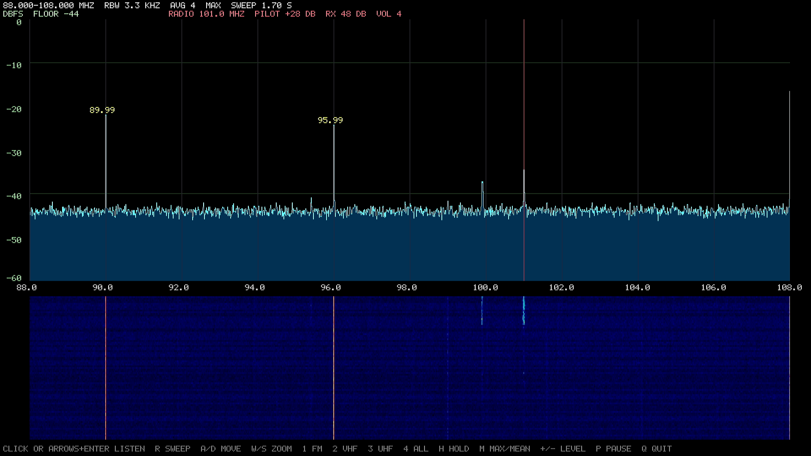

# specan: live spectrum analyzer and FM radio

`tools/board/specan.c` draws a live FFT spectrum and waterfall on HDMI and plays
an FM station on HDMI, live. Pick the station with a USB mouse click or the arrow
keys. It samples the raw ADC of the on-die demodulator from the MIPS CPU; there is
no DMA path for those samples. MStar code is not involved: the sound goes through
our own SE DSP program (`own_audio.h`, see [own_dsp_audio.md](own_dsp_audio.md)).

Tested on the board with a piece of wire on the floor as the antenna. Sound is
mono and noisy with that antenna. The mouse was tested through a USB hub; the USB
keyboard and front panel keys were not tested.



Listening to 101.0 MHz (red marker). The tall lines at 90 and 96 MHz are the box's
own 6 MHz comb; 99.9 and 101.0 MHz are real stations, which is why they come and go in
the waterfall while the comb stays constant.

## Running it

```sh
# on the PC: musl toolchain from the Buildroot of the flash rootfs, see build_manual.md
mipsel-buildroot-linux-musl-gcc -O2 -static -pthread -o specan tools/board/specan.c -lm
python3 tools/serial/upload.py specan /tmp/specan

# at the MBoot prompt: the ADC and the demod 8051 must run before Linux starts
tuner_init
run bootcmd

# in Linux: Ctrl-C stops fbDOOM on the serial console, then
chmod +x /tmp/specan; /tmp/specan 88 108     # or -F 101000 to start listening at once
```

| Input | Action |
|---|---|
| left click | listen to this frequency (rounded to 100 kHz) |
| wheel, left/right arrows | move the marker by 100 kHz |
| right click | radio off |
| Enter | radio on/off |
| `r` | new sweep (sound stops for about 2 s) |
| `+` / `-` | volume while listening, otherwise reference level |
| `a`/`d`, up/down or `w`/`s` | move the view, zoom |
| `1`-`4` | FM, VHF, UHF, whole band |
| `h`, `m`, `p`, `q` | max hold, max/mean per column, pause, quit |

The sweep stops while listening. The status line shows the 19 kHz pilot level
against an empty 17 kHz; it jumps around on weak stations.

Diagnostics: `-v` peaks on the console, `-S` list all peaks without the screen,
`-R` raw peaks of each single tuning, `-C` tuner clock output off.

If USB devices time out (`error -145`) after one was unplugged, stop `specan` and
run `tools/board/usbfix.sh`, which reloads the EHCI driver. What exactly triggers
the failure is not known yet.

## How the spectrum works

- Samples are read from RIU `0x112098` with the demod bus owner `0x101E39` set to
  0, about 9.09 MS/s, each with a CP0 Count timestamp. FFT windows only use
  stretches without interrupt gaps. The FFT is integer only (the CPU has no FPU).
- That rate folds the IF band around 4.54 MHz, so each bin holds two RF frequencies,
  mirrored around the tuning. Each RF point is measured from several tunings and a
  low reading wins (the second smallest from 4 readings up): an image lands elsewhere
  at each tuning, a real signal stays. Quickly changing signals can come out narrower
  and weaker, so FM stations look small. Long averaging shows them better:
  `-S -D -M -a 32`.

## How the radio works

- **VPE1** only samples: every sample is mixed with an NCO stepped by its own
  timestamp, so gaps keep the phase, and averaged into 120 kS/s I/Q (about 5.5 MS/s).
- **VPE0** demodulates in integers: 45 kHz FIR, discriminator, 80 Hz high-pass, 50 us
  de-emphasis, 7 kHz low-pass, 120 to 48 kHz, DSP. Both ends run from the SoC crystal,
  so the buffer does not drift.
- A 100 % real-time thread gets stopped by the kernel for 50 ms every second
  (`sched_rt_runtime_us`), which was an audible click. `specan` turns the limit off
  while it runs and restores it on exit, and the sampler briefly yields every 0.25 s.

## What is in the spectrum

Most lines seen with this antenna are made by the box itself:

| Lines | Source | Evidence |
|---|---|---|
| multiples of 6 MHz, 48-864 MHz, up to -5 dBFS | something locked to the **tuner's** 24 MHz crystal (mechanism unknown) | constant offset over the whole band |
| 148.5, 222.75, 371.25, 445.5, 742.5 MHz | **HDMI transmitter** | they vanish with TMDS and the PLL off (445.5 MHz only by frequency) |
| exactly at the tuned frequency, about -28 dBFS | **tuner LO leak**, stronger in the first 10 ms | reads RF = tuning to 0.3 kHz |

The HDMI lines drift 6.3 ppm against the tuner's LO, while vsync is locked to the CPU
clock within 0.02 ppm. So the SoC and tuner crystals differ by 6.3 ppm, and the 6 MHz
comb does not have that offset: it does not come from SoC clocks, even at 432 or
552 MHz. The real tuner IF is about 4.5953 MHz, not the nominal 4.57.

**Correction:** the "FM station at 96.03 MHz" in earlier notes is 16 x 6 MHz, not radio.

Real stations were told apart by the 19 kHz stereo pilot after demodulation: 101.0 MHz
(+27 dB from 8 s), 91.1 and 99.9 MHz (+12 and +11 dB from 1 s). 98.1 MHz (+4.6 dB) is
uncertain. The tuning at 219 MHz is reproducibly bad (LO 28 kHz off, lines about 25 dB
down), cause unknown. Details: [pl/falszywe_sygnaly.md](pl/falszywe_sygnaly.md),
[pl/odbior_fm.md](pl/odbior_fm.md), [pl/analizator_widma.md](pl/analizator_widma.md).

## Recording

`tools/board/fmrx.c` records one channel as I/Q (`fmrx RF_KHZ TUNE_MHZ SECONDS FILE.i8 [BIN]`).
Fetch it with `tools/serial/uart_get.py` and demodulate on the PC with `tools/fm_demod.py`,
which also prints the pilot test. `fmrx` still has the 1 s clicks.

The other ADC tools: `tools/board/dmdts.c` (timestamped samples, spectra with
`tools/adc_spectrum.py`), `tools/board/dmdraw.c` (raw samples and statistics),
`tools/board/dmdbank.c` (demod RIU bank dump; reading bank `0x1116` hangs the board).

Test without hardware: `gcc -DHOST -O2 -o specan_host tools/board/specan.c -lm &&
./specan_host -v -x 2 88 108` simulates the tuner and ADC and writes a PPM.
